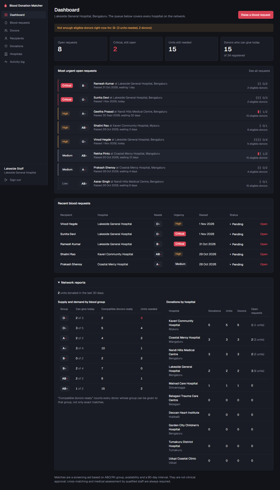

# Blood Donation Urgency & Compatibility Matcher

DBMS Level 3 project, PES University.

A web application that helps hospitals find suitable blood donors for a request, based on **blood-group compatibility**, **donor availability**, a **90-day donation interval**, **request urgency** and **units required**.

> **Not a clinical tool.** All data is fictional. A "match" is a screening aid; it is never approval for transfusion. Cross-matching and medical assessment by qualified staff are always required. The 90-day interval is a simplified project assumption, not a complete eligibility assessment.

| | |
|---|---|
| Frontend + API | Next.js 16 (App Router, Route Handlers), TypeScript, Tailwind CSS 4 |
| Primary database | MySQL 8 — 6 core tables, transactions, triggers, stored procedures/functions, views, indexes, full-text search |
| Second paradigm | MongoDB — `activity_logs` collection, indexes, aggregation pipeline |
| Auth | Two roles (hospital staff, donor), bcrypt password hashes, signed httpOnly session cookie |
| Tests | Vitest (database, services, HTTP API) and Playwright (browser), all against real MySQL and MongoDB |



## What it does

- **Hospital staff** register donors and recipients, raise blood requests, see the open requests ranked Critical → Low, get a ranked list of compatible donors for a request, record donations (partial and full fulfilment), cancel requests, and view hospital-wise statistics and the activity log.
- **Donors** register themselves, switch their availability on and off, and see their donations, their eligibility date and the open requests their blood group can help.
- Every change is written to a **MongoDB activity log**, with statistics per day or week from an aggregation pipeline.

## Run it

### 1. Prerequisites

- Node.js 20.9 or newer (developed on 22)
- MySQL 8.0 running locally
- MongoDB running locally (4.2 or newer recommended; see "Verified versions" below)

### 2. Install and configure

```bash
npm install
cp .env.example .env.local        # Windows PowerShell: Copy-Item .env.example .env.local
```

Edit `.env.local`: set `MYSQL_USER` / `MYSQL_PASSWORD`, and set `AUTH_SECRET` to the output of

```bash
node -e "console.log(require('crypto').randomBytes(32).toString('hex'))"
```

The simplest setup uses one MySQL account that is allowed to create databases (for example `root`) for both `MYSQL_USER` and `MYSQL_ADMIN_USER`. For the recommended least-privilege setup see `sql/07_app_user.example.sql`.

### 3. Create the database and load the demo data

```bash
npm run db:setup -- --seed
```

This creates the `blood_matcher` database, runs `sql/01` … `sql/05`, loads the fictional demo data and creates ten demo logins (five hospital staff, five donors). MongoDB needs no setup: the collection, its validator and its indexes are created on first use.

| Demo login | Role | Password |
|---|---|---|
| `staff@lakeside.test` | Hospital staff, Lakeside General Hospital | `Demo@12345` |
| `staff@kaveri.test` | Hospital staff, Kaveri Community Hospital | `Demo@12345` |
| `arjun@donor.test` | Donor (O+) | `Demo@12345` |
| `meera@donor.test` | Donor (O−) | `Demo@12345` |

Also seeded: `staff@nandihills.test`, `staff@malnad.test`, `staff@coastalmercy.test`, `kiran@donor.test`, `divya@donor.test`, `rahul@donor.test` (same password).

Set `SEED_PASSWORD` in `.env.local` before seeding to use a different password. For an installation without demo data, create the first staff login with `node scripts/db.mjs create-staff …` (usage at the top of `scripts/db.mjs`).

### 4. Start

```bash
npm run dev          # http://localhost:3000
```

or, for a production build: `npm run build && npm start`.

### Useful commands

| Command | What it does |
|---|---|
| `npm run db:status` | Lists tables, views, routines and triggers that exist |
| `npm run db:reset -- --yes --seed` | **Deletes everything** in the database and rebuilds it with demo data |
| `npm run logs:flush` | Copies any activity events still waiting in MySQL to MongoDB |
| `npm run lint` / `npm run typecheck` | Static checks |

## Tests

Tests never touch your development data: they use separate databases named in `.env.test`.

```bash
cp .env.local .env.test
# in .env.test change:  MYSQL_DATABASE=blood_matcher_test   MONGODB_DB=blood_matcher_logs_test
npm run db:test:setup

npm test             # database + service tests            (Vitest)
npm run test:api     # builds the app, then HTTP API tests  (Vitest)
npx playwright install chromium   # once
npm run test:e2e     # browser tests; also refreshes docs/screenshots
```

The test tools refuse to run unless both database names contain `test`. Results of the last full run are in [docs/TESTING.md](docs/TESTING.md).

## Verified versions

Everything was built and tested on MySQL **8.0.46** and MongoDB **3.6.8** (the only MongoDB server available in the build environment), with Node 22 on Linux. The code uses no feature newer than MongoDB 3.6 and the `mongodb` driver is pinned to **6.9.0**, which officially supports servers 3.6 through 8.0. **Before the demo, run the three test suites once on your own machine** to confirm them against your MongoDB version; the GitHub Actions workflow (`.github/workflows/ci.yml`) does the same on MySQL 8.0 + MongoDB 7 but has not been run yet.

## Documentation

| Document | Contents |
|---|---|
| [docs/DATABASE.md](docs/DATABASE.md) | Problem statement, ER diagram, relational schema, design decisions, advanced SQL features, important queries |
| [docs/DATA_DICTIONARY.md](docs/DATA_DICTIONARY.md) | Every column, constraint, index and trigger (generated from the live schema) |
| [docs/MONGODB.md](docs/MONGODB.md) | Why MongoDB, document model, indexes, aggregation pipeline, MySQL↔MongoDB consistency |
| [docs/ARCHITECTURE.md](docs/ARCHITECTURE.md) | System architecture, request flow, API reference, security |
| [docs/TESTING.md](docs/TESTING.md) | Test cases and actual results |
| [docs/DEMO.md](docs/DEMO.md) | Step-by-step demonstration script |
| `sql/` | DDL, migration, routines, views, seed data and the demo queries |
| `docs/evidence/` | Captured output of the demo queries and test runs |

## Project layout

```
sql/                 00 drop · 01 baseline schema · 02 migration (ALTER) · 03 routines · 04 views
                     05 compatibility data · 06 demo seed · 07 app-user example · 08 demo queries
scripts/             db.mjs (setup/seed/reset/status) · flush-logs.ts · data-dictionary.mjs
src/lib/             mysql.ts · mongo.ts · activity.ts (outbox) · auth.ts · validation.ts · errors.ts
src/lib/services/    business logic: hospitals, donors, recipients, requests, donations, stats, users
src/app/api/         Route Handlers (thin: authenticate → validate → call a service)
src/app/(staff)/     staff pages    src/app/(donor)/  donor page    src/app/(public)/  sign in / register
src/components/      UI components
tests/               db/ · services/ · api/      e2e/  browser tests
```
