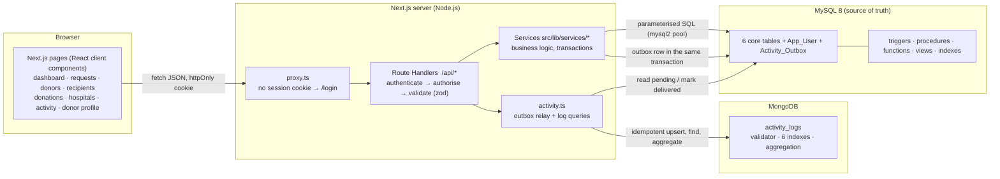

# System architecture

## Layers

| Layer | Files | Responsibility |
|---|---|---|
| Pages | `src/app/(staff)`, `(donor)`, `(public)`, `src/components` | Forms, tables, loading / empty / error states. No data is hard-coded; everything comes from `/api`. |
| Page guard | `src/proxy.ts` | Convenience redirect to `/login` when there is no session cookie. Not a security boundary. |
| Route Handlers | `src/app/api/**/route.ts` | `requireUser(request, role)`, parse input with zod, call one service, return `{ data, meta }` or `{ error }`. |
| Services | `src/lib/services/*.ts` | All business logic and every transaction. Callable directly from tests. |
| Data access | `src/lib/mysql.ts`, `src/lib/mongo.ts` | Connection pools, `withTransaction()` (commit / rollback / deadlock retry), conversion of MySQL errors to API errors. |
| Database | `sql/*.sql` | Integrity rules live here (constraints, triggers, procedure), so they hold for any client. |

## One request, end to end: recording a donation

1. Staff clicks **Record** next to a matching donor → `POST /api/donations {donor_id, request_id, units_donated}`.
2. Route handler: verifies the session token and the STAFF role, validates the body (422 with per-field messages on failure).
3. `recordDonation()` opens a transaction, locks the request row, checks it belongs to the staff member's hospital, and calls `sp_record_donation`.
4. The procedure checks the date, donor availability and the 90-day rule, then inserts the row. `trg_donation_before_insert` checks status, remaining units, hospital and compatibility; `trg_donation_after_insert` updates the request and the donor; `trg_request_before_update` recalculates the status.
5. The service writes `donation_recorded` (and `request_status_changed` if the status moved) to `Activity_Outbox`, then commits.
6. After the commit the outbox is flushed to MongoDB. The response is `201` with the donation, the request's new state and `meta.activity_log`.
7. Any rule violation raises a MySQL error that is mapped to a status code and message, e.g. `409 OVER_FULFILLMENT` "That is more units than the request still needs."

## API reference

All responses are JSON: `{ "data": …, "meta": … }` on success, `{ "error": { "code", "message", "fields"? } }` on failure. Status codes: 400 malformed, 401 not signed in, 403 wrong role or wrong hospital, 404 not found, 409 conflicts with the current state, 422 invalid input, 503 database unavailable.

| Method and path | Role | Purpose |
|---|---|---|
| `POST /api/auth/login` · `POST /api/auth/logout` · `GET /api/auth/me` | any | Session |
| `POST /api/auth/register` | public | Donor self-registration (Donor + login in one transaction) |
| `POST /api/users` | staff | Add a staff login for the caller's hospital |
| `GET /api/stats` | staff | Dashboard: totals, queue, blood-group overview, hospital statistics, shortages |
| `GET, POST /api/hospitals` · `GET, PATCH, DELETE /api/hospitals/:id` | staff | Hospitals (`?q=` search); POST may include `first_staff` |
| `GET, POST /api/donors` · `GET, PATCH, DELETE /api/donors/:id` | staff; donor for own record | Donors (`?q=` full-text, `?blood_group=`, `?availability=`, `?ready=yes\|no`) |
| `PATCH /api/donors/:id/availability` | staff; donor for own record | Switch availability (logged) |
| `GET /api/donors/:id/requests` | staff; donor for own record | Open requests this donor's group can help |
| `GET, POST /api/recipients` · `GET, PATCH, DELETE /api/recipients/:id` | staff | Recipients (`?scope=mine\|all`); created at the caller's hospital |
| `GET, POST /api/requests` · `GET, PATCH /api/requests/:id` | staff | Requests (`?status=open\|all\|Pending\|…`, `?urgency=`, `?blood_group=`, `?hospital_id=`) |
| `POST /api/requests/:id/cancel` | staff, own hospital | Cancel |
| `GET /api/requests/:id/matches` | staff | Ranked compatible donors (`?include_ineligible=1`) |
| `GET, POST /api/donations` · `DELETE /api/donations/:id` | staff | Donations; POST and DELETE only for the caller's hospital |
| `GET /api/activity` | staff; donor sees own only | Activity history from MongoDB |
| `GET /api/activity/stats` | staff | Aggregation: events per day/week |
| `POST /api/activity/reconcile` | staff | Deliver pending outbox events to MongoDB |
| `GET /api/health` | public | `{ mysql, mongodb }` up/down |

## Authentication and authorisation

- Passwords are hashed with **bcrypt** (cost 10). The database refuses anything that is not a 60-character bcrypt hash (`chk_user_hash`).
- A successful login sets a **signed JWT (HS256)** in an `httpOnly`, `SameSite=Lax` cookie valid for 8 hours (`Secure` in production). JavaScript in the page cannot read it.
- Every API route calls `requireUser()`, which verifies the signature and expiry and checks the role. Login failures return the same message and take the same time whether or not the email exists.
- **Roles:** `STAFF` (linked to one hospital) and `DONOR` (linked to one donor); the link is enforced by `chk_user_role_link`.
- **Ownership rules:** staff can view the whole network but can only create or change recipients, requests and donations for **their own hospital**; a donor can only read or change **their own** record and only sees log events about themself.

## Security practices

| Practice | Where |
|---|---|
| No credentials in source code; everything from environment variables | `src/lib/env.ts`, `.env.example`; `.env*` is git-ignored |
| Parameterised SQL only (placeholders, never string concatenation of input) | `src/lib/mysql.ts` and all services |
| Server-side validation of every input, repeated by database constraints | `src/lib/validation.ts`, `sql/02_migration.sql` |
| Least-privilege database account for the app (DML + EXECUTE, no DDL) | `sql/07_app_user.example.sql`; the test suites run the app under such an account |
| Errors never expose SQL or stack traces to the client | `src/lib/errors.ts`, `src/lib/http.ts` |
| Destructive scripts need an explicit flag; tests refuse non-test databases | `scripts/db.mjs`, `tests/helpers.ts` |

Not implemented: login rate limiting, password reset/change, CSRF tokens (mitigated by SameSite cookies and JSON-only bodies), field-level encryption, HTTPS termination.
