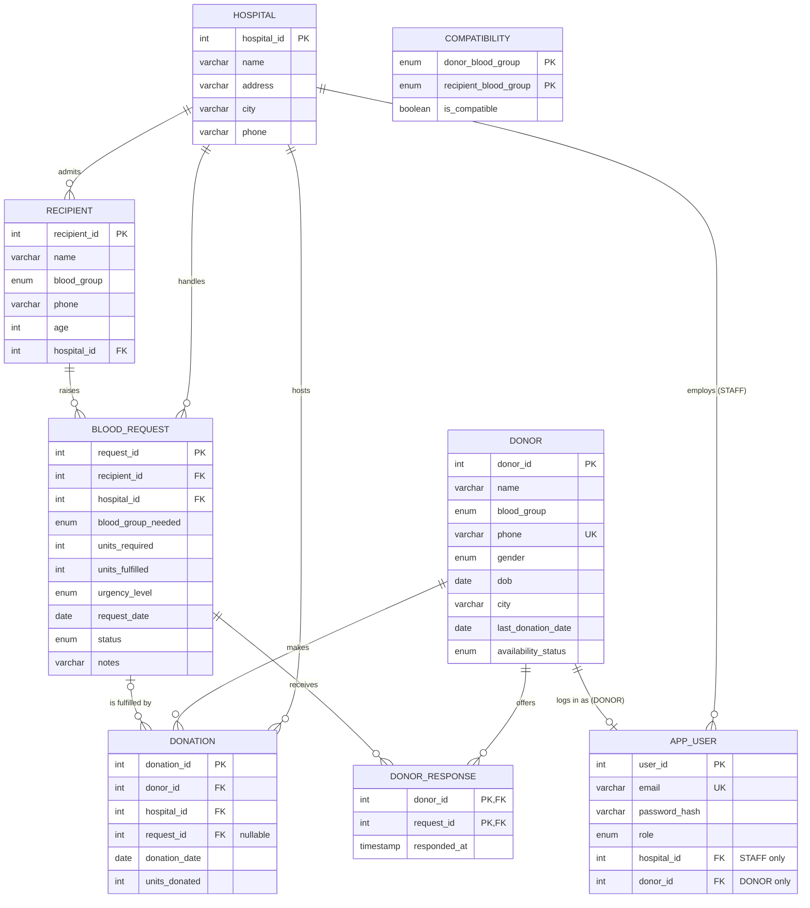

# Database design (MySQL)

## 1. Problem statement

Blood banks and hospitals often struggle to quickly locate compatible, available donors during emergencies, and delays can be life-threatening. This system matches donors to blood requests using blood-group compatibility, urgency level and donor availability, so hospital staff can respond to the most critical requests first.

**Users:** hospital staff (manage recipients, requests, donations) and donors (manage their own availability).

**Objectives**

1. Store donors, recipients, hospitals, requests and donations with enforced integrity.
2. Rank open requests by urgency and age.
3. For any request, list donors who are compatible, available and eligible, in a useful order.
4. Record donations atomically and keep request fulfilment exact, including under concurrent use.
5. Keep an auditable history of every change in a second database suited to that data.

**Scope.** In scope: everything above, two user roles, hospital-wise statistics. Out of scope: clinical eligibility (haemoglobin, illness, medication), cross-matching, component types (platelets, plasma), blood stock/expiry, notifications to donors.

**Assumptions (documented simplifications, not medical rules)**

- A donor may donate again **90 days** after their last donation. A missing last-donation date means "no donation on record" and is treated as eligible.
- Compatibility is whole-blood/red-cell ABO + RhD compatibility only.
- One donation yields 1 unit (2 allowed), so a request may need several donors. A request asks for at most 20 units.
- A request is raised at the hospital where its recipient is registered.

## 2. ER diagram



`COMPATIBILITY` is a lookup table: it is joined on blood-group values (`Donor.blood_group`, `Blood_Request.blood_group_needed`) rather than through foreign keys, because the eight groups are a fixed domain enforced by identical `ENUM`s.

**The Week 4 Chen diagram needs one addition** before it is reused in the final report: the `HANDLES` relationship between Hospital and Blood_Request (1:N), plus the `units_fulfilled` attribute on Blood_Request.

| Relationship | Between | Cardinality | Enforced by |
|---|---|---|---|
| ADMITS | Hospital – Recipient | 1 : N | `fk_recipient_hospital` |
| HANDLES | Hospital – Blood_Request | 1 : N | `fk_request_hospital` |
| HOSTS | Hospital – Donation | 1 : N | `fk_donation_hospital` |
| RAISES | Recipient – Blood_Request | 1 : N | `fk_request_recipient` |
| MAKES | Donor – Donation | 1 : N | `fk_donation_donor` |
| FULFILLS | Blood_Request – Donation | 1 : N, optional on the donation side | `fk_donation_request` (nullable) |
| OFFERS | Donor – Blood_Request | M : N, through Donor_Response | `fk_response_donor`, `fk_response_request` |

## 3. Relational schema

Primary keys are underlined, foreign keys are in *italics*.

- **Hospital**(<u>hospital_id</u>, name, address, city, phone, created_at) — UNIQUE(name, city)
- **Donor**(<u>donor_id</u>, name, blood_group, phone, gender, dob, city, last_donation_date, availability_status, created_at) — UNIQUE(phone)
- **Recipient**(<u>recipient_id</u>, name, blood_group, phone, age, *hospital_id*)
- **Blood_Request**(<u>request_id</u>, *recipient_id*, *hospital_id*, blood_group_needed, units_required, units_fulfilled, urgency_level, request_date, status, notes, created_at, updated_at)
- **Donation**(<u>donation_id</u>, *donor_id*, *hospital_id*, *request_id*, donation_date, units_donated, created_at)
- **Compatibility**(<u>donor_blood_group</u>, <u>recipient_blood_group</u>, is_compatible)
- **App_User**(<u>user_id</u>, email, password_hash, display_name, role, *hospital_id*, *donor_id*, created_at) — UNIQUE(email), UNIQUE(donor_id)
- **Activity_Outbox**(<u>outbox_id</u>, event_id, payload, created_at, delivered_at, attempts, last_error) — UNIQUE(event_id)
- **Donor_Response**(<u>*donor_id*</u>, <u>*request_id*</u>, responded_at)

Every column, type, default, CHECK, index and trigger is listed in [DATA_DICTIONARY.md](DATA_DICTIONARY.md).

**Normalisation.** All tables are in 3NF. Two deliberate, controlled redundancies exist, both guarded by the database so they cannot drift:

| Derived column | Why it is stored | What keeps it correct |
|---|---|---|
| `Blood_Request.units_fulfilled`, `status` | The queue and every over-fulfilment check need it constantly; recomputing `SUM(units_donated)` under a lock for every read would be slower and racy | Written only by the Donation triggers; `CHECK (units_fulfilled <= units_required)`; status recalculated by `trg_request_before_update` |
| `Blood_Request.hospital_id` | Direct "requests of a hospital" lookups and a simple hospital check on donations | `trg_request_before_insert` rejects a value different from the recipient's hospital |

## 4. How the schema is built (DDL)

| File | Demonstrates |
|---|---|
| `sql/01_schema.sql` | `CREATE TABLE`, PK, FK, `CHECK`, `ENUM`, `CREATE INDEX` — the Week 4 submission, unchanged |
| `sql/02_migration.sql` | `ALTER TABLE` (ADD/MODIFY COLUMN, ADD CONSTRAINT, DROP/ADD FOREIGN KEY), `DROP INDEX`, FULLTEXT index, `UPDATE … JOIN` backfill, two new tables |
| `sql/03_routines.sql` | `CREATE FUNCTION`, `CREATE PROCEDURE`, `CREATE TRIGGER` |
| `sql/04_views.sql` | `CREATE OR REPLACE VIEW` |
| `sql/05_reference_data.sql` | `INSERT … SELECT` over a `CROSS JOIN` |
| `sql/09_donor_response.sql` | Composite primary key, `ON DELETE CASCADE` |
| `sql/00_drop.sql` | `DROP VIEW / PROCEDURE / FUNCTION / TABLE` (used by `npm run db:reset`) |

### What changed since Week 4, and why

| Change | Reason |
|---|---|
| `Blood_Request.hospital_id` added (NOT NULL, FK) | The explainer listed it but the DDL did not have it; requests are now directly tied to a hospital |
| `Blood_Request.units_fulfilled` added with a CHECK | Makes partial fulfilment explicit and over-fulfilment impossible |
| `fk_donation_donor` and `fk_request_recipient`: CASCADE → RESTRICT | Deleting a donor or recipient must not silently erase donation/request history |
| `Donor.phone` UNIQUE; phone/name/age CHECKs | Requirement 12: validation at the database level |
| `idx_donor_bg_avail` and `idx_request_urgency` dropped and replaced | Re-designed around the real queries (see §6.5) |
| `App_User`, `Activity_Outbox` created | Authentication (requirement 11) and reliable MongoDB logging |

## 5. Business rules and where each is enforced

| Rule | Enforced in |
|---|---|
| Blood group is one of the 8 ABO/Rh groups | `ENUM` on every blood-group column |
| Donor can give to recipient only if compatible | `Compatibility` table; `trg_donation_before_insert`; `sp_match_donors` |
| The requested group must be one the recipient can receive | `trg_request_before_insert` |
| A request is raised at the recipient's hospital | `trg_request_before_insert` |
| A new request starts Pending with 0 units | `trg_request_before_insert` |
| Status follows the units (Pending / Partially_Fulfilled / Fulfilled) | `fn_request_status` via `trg_request_before_update` |
| No over-fulfilment, ever | `trg_donation_before_insert` (row lock) + `chk_request_fulfilled` |
| No donation to a cancelled or fulfilled request | `trg_donation_before_insert` |
| A cancelled request cannot be reopened; a fulfilled one cannot be cancelled | `trg_request_before_update` |
| Donation happens at the request's hospital | `trg_donation_before_insert` |
| Donor must be available and outside the 90-day interval | `sp_record_donation` (`fn_is_donor_eligible`) |
| Donation date not in the future | `sp_record_donation` |
| Donations are immutable (delete and re-enter) | `trg_donation_before_update` |
| Deleting a donation reverses its effects | `trg_donation_after_delete` |

**Triggers and the application never do the same job.** Triggers own every *derived* value (`units_fulfilled`, `status`, `last_donation_date`). The stored procedure owns the *policy* checks and the insert. The application only opens the transaction, calls the procedure and writes the activity event. Nothing is updated twice, and the rules hold even for SQL typed straight into the MySQL client.

## 6. Advanced database features

The brief asks for at least four; six are implemented and tested.

### 6.1 Transactions

`recordDonation()` in `src/lib/services/donations.ts`:

```
START TRANSACTION
  SELECT … FROM Blood_Request WHERE request_id = ? FOR UPDATE     -- lock + remember old status
  CALL sp_record_donation(…)                                       -- checks + INSERT; triggers update request and donor
  INSERT INTO Activity_Outbox …                                    -- the activity events
COMMIT            (any error → ROLLBACK of everything)
```

- **Atomicity:** a donation never exists without its fulfilment update and its log event. Tested by forcing a failure after the insert and checking nothing remains.
- **Isolation / concurrency:** the request row is locked with `SELECT … FOR UPDATE`, so two staff recording a donation for the last unit at the same moment are serialised; the second sees the updated count and is refused. Locks are always taken request → donor, and InnoDB deadlocks (if any) are retried up to three times.
- Also transactional: donor self-registration (Donor + App_User), hospital + first staff login, cancelling/editing a request, availability changes, deleting a donation.

### 6.2 Triggers (6)

`trg_request_before_insert`, `trg_request_before_update`, `trg_donation_before_insert`, `trg_donation_after_insert`, `trg_donation_before_update`, `trg_donation_after_delete` — see §5 for what each enforces. Violations raise `SIGNAL SQLSTATE '45000'` with a code such as `OVER_FULFILLMENT`, which the API turns into a clear message.

### 6.3 Stored procedures and functions (4)

| Routine | Purpose |
|---|---|
| `fn_is_donor_eligible(last_donation, as_of)` | The 90-day rule, defined once; used by the procedure, three views and the matching query |
| `fn_request_status(required, fulfilled)` | Single definition of how units map to a status |
| `sp_match_donors(request_id, only_eligible)` | Ranked compatible donors: eligible first, exact group, same city as the hospital, longest since last donation |
| `sp_record_donation(donor, hospital, request, date, units, OUT id)` | Validates and inserts a donation; has no COMMIT of its own so it joins the caller's transaction |

### 6.4 Views (5)

| View | Used for |
|---|---|
| `vw_request_queue` | Open requests with units remaining, days waiting and a count of donors who could give today (correlated subquery) |
| `vw_donor_eligibility` | Each donor with days since donation, eligibility, next eligible date, `can_donate_now` |
| `vw_hospital_donation_stats` | Hospital-wise donations, units, distinct donors, open requests (LEFT JOIN + GROUP BY) |
| `vw_blood_group_overview` | Supply vs demand for each of the 8 groups |
| `vw_donation_history` | Flat donation list for screens |

### 6.5 Indexing

| Index | Supports | Evidence |
|---|---|---|
| `idx_donor_match (availability_status, blood_group, last_donation_date)` | The matching filter; covering for the 90-day check | `EXPLAIN` → `range`, `Using index` |
| `idx_request_queue (status, urgency_level, request_date)` | The queue: filter on status, already sorted by urgency then age because the ENUM is declared Critical, High, Medium, Low | `EXPLAIN` → `ref`, `Using index`, no filesort |
| `idx_donation_donor (donor_id, donation_date)` | A donor's history; recomputing the last donation date after a delete | |
| `idx_donation_hospital_date (hospital_id, donation_date)` | Hospital statistics | |
| `uq_donor_phone`, `uq_user_email`, `uq_hospital_name_city`, `uq_outbox_event` | Uniqueness rules | |

`EXPLAIN` output is in `docs/evidence/demo_queries.txt`.

### 6.6 Full-text search

`ALTER TABLE Donor ADD FULLTEXT INDEX ft_donor_name_city (name, city)`; the donor search box runs `MATCH(name, city) AGAINST ('+term*' IN BOOLEAN MODE)`. InnoDB ignores words shorter than 3 characters, so short searches fall back to `LIKE`.

## 7. Important queries

All are in `sql/08_demo_queries.sql` with captured output in `docs/evidence/demo_queries.txt`.

| # | Query | SQL features |
|---|---|---|
| Q1 | Priority queue of open requests | view, ORDER BY |
| Q2–Q3 | Compatible donors for a request | stored procedure, 4-table JOIN |
| Q4 | The same match as a plain query | nested subqueries, IN |
| Q5 | Donor eligibility | view, function |
| Q6 | Hospital-wise statistics | LEFT JOIN, GROUP BY, COUNT/SUM/MAX, COUNT(DISTINCT) |
| Q7 | Shortage alert per blood group | GROUP BY, HAVING |
| Q8 | Donations per month and group | JOIN, GROUP BY, ORDER BY |
| Q9 | Supply vs demand | view on subqueries |
| Q10 | Donor search | FULLTEXT |
| Q11 | Index usage | EXPLAIN |
| Q12 | Donation inside a transaction, then ROLLBACK | transaction, procedure, triggers |

DML in the application: `INSERT` (every registration and donation), `UPDATE` (availability, request edits, cancellation), `DELETE` (donor/recipient/hospital when unreferenced, donation with trigger reversal), `SELECT` everywhere.

## 8. Database choice and justification

**MySQL for the core data.** Donors, recipients, hospitals, requests and donations are structured and relationship-heavy; correctness depends on foreign keys, CHECK constraints and multi-row transactions (a donation must update a request atomically). That is exactly what a relational database provides.

**MongoDB for the activity log** — see [MONGODB.md](MONGODB.md).
