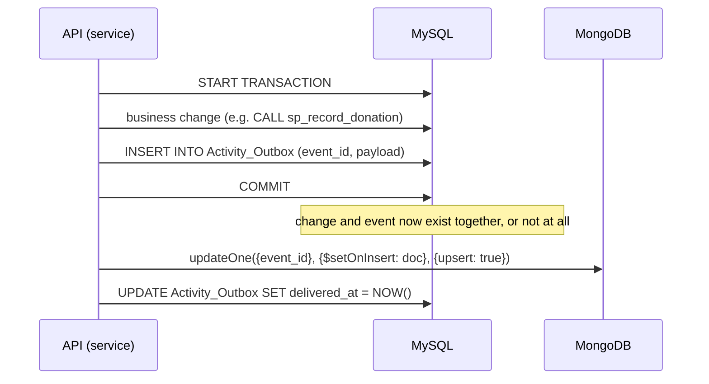

# MongoDB: the activity log

## Why a second database, and why a document store

Every change (a donor switching availability, a request being raised, a status change, a donation) is recorded as an activity event. This data is a poor fit for a relational table and a good fit for documents:

- **The shape differs per action.** An availability change has `old_status` / `new_status`; a new request has `blood_group`, `units_required`, `urgency`; a request edit has a `changes` map. A SQL table would need a wide row of mostly-NULL columns or a generic text blob.
- **Append-only and write-heavy.** Events are inserted and never updated.
- **Read by simple lookups and roll-ups.** "Everything that happened to donor 12" or "events per week by action" — no joins.

MongoDB is not used for anything that needs relational integrity. It never decides whether a donation is allowed.

## Data model

Database `blood_matcher_logs`, collection `activity_logs`. Two real documents:

```json
{
  "event_id": "7d2c6c0e-2f0a-4c1b-9a53-0e1f3f1f4a11",
  "entity_type": "donor",
  "entity_id": 12,
  "action": "donor_availability_changed",
  "timestamp": { "$date": "2026-10-10T18:32:11.482Z" },
  "details": { "old_status": "Available", "new_status": "Unavailable" },
  "performed_by": { "user_id": 3, "role": "DONOR", "email": "arjun@donor.test" },
  "related": { "donor_id": 12 }
}
```
```json
{
  "event_id": "…",
  "entity_type": "request",
  "entity_id": 13,
  "action": "request_status_changed",
  "timestamp": { "$date": "2026-10-10T18:32:40.019Z" },
  "details": { "old_status": "Pending", "new_status": "Partially_Fulfilled",
               "units_fulfilled": 1, "units_required": 2,
               "reason": "donation recorded", "donation_id": 15 },
  "performed_by": { "user_id": 1, "role": "STAFF", "email": "staff@lakeside.test" },
  "related": { "request_id": 13, "hospital_id": 1, "donor_id": 11 }
}
```

| Field | Meaning |
|---|---|
| `event_id` | UUID created in MySQL with the change; makes delivery idempotent |
| `entity_type`, `entity_id` | What the event is about: `donor`, `request`, `donation`, `hospital`, `recipient` + its MySQL id |
| `action` | One of the actions below |
| `timestamp` | BSON date (UTC) |
| `details` | Free-form, depends on the action |
| `performed_by` | Who did it (metadata from the login session) |
| `related` | Ids of other records involved, so one donor's or request's complete history is a single indexed lookup |

Actions: `donor_registered`, `donor_availability_changed`, `donor_profile_updated`, `donor_offered_help`, `donor_withdrew_help`, `request_created`, `request_updated`, `request_status_changed`, `donation_recorded`, `donation_deleted`, `recipient_registered`, `hospital_registered`.

A `$jsonSchema` validator on the collection requires the common fields and their types and restricts `entity_type` to the five values, while leaving `details` open.

## Indexes

| Index | Keys | Purpose |
|---|---|---|
| `uq_event_id` (unique) | `event_id` | Idempotent delivery: the same event can never be stored twice |
| `idx_entity_history` | `entity_type, entity_id, timestamp desc` | History of one record, newest first |
| `idx_timestamp` | `timestamp desc` | Recent-activity feed; date-range scan for statistics |
| `idx_action_time` | `action, timestamp desc` | Feed filtered by action |
| `idx_related_donor` (sparse) | `related.donor_id, timestamp desc` | Everything that touched a donor |
| `idx_related_request` (sparse) | `related.request_id, timestamp desc` | Everything that touched a request |

A test checks with `explain()` that the history query uses `idx_entity_history` and does not scan the collection.

## Retrieval

- `GET /api/activity` — filtered `find()` sorted by `timestamp` descending, with `limit` / `skip`. Filters: `entity_type`, `entity_id`, `action`, `donor_id`, `request_id`, `from`, `to`. A donor only ever receives events related to themself.
- `GET /api/activity/stats?granularity=day|week&days=N` — the aggregation below.

## Aggregation pipeline (advanced NoSQL feature)

`activityStats()` in `src/lib/activity.ts`. One pipeline returns events per day (or ISO week) broken down by action, plus totals per action and per entity type:

```js
[
  { $match: { timestamp: { $gte: from, $lt: to } } },
  { $facet: {
      by_period: [
        { $group: { _id: { period: { $dateToString: { format: "%Y-%m-%d",      // "%G-W%V" for weeks
                                                       date: "$timestamp", timezone: "+05:30" } },
                           action: "$action" },
                    count: { $sum: 1 } } },
        { $sort: { "_id.action": 1 } },
        { $group: { _id: "$_id.period", total: { $sum: "$count" },
                    actions: { $push: { action: "$_id.action", count: "$count" } } } },
        { $sort: { _id: 1 } },
        { $project: { _id: 0, period: "$_id", total: 1, actions: 1 } }
      ],
      by_action:      [ { $group: { _id: "$action",      count: { $sum: 1 } } }, { $sort: { count: -1, _id: 1 } }, … ],
      by_entity_type: [ { $group: { _id: "$entity_type", count: { $sum: 1 } } }, { $sort: { count: -1, _id: 1 } }, … ]
  } }
]
```

Days and weeks are bucketed in the application time zone (`APP_TIMEZONE`), so an event at 00:30 IST on Monday counts for Monday, not Sunday. This is tested with fixed timestamps.

## Keeping MySQL and MongoDB consistent

MySQL and MongoDB cannot commit in one transaction. Writing to MongoDB from inside the MySQL transaction would create two failure modes: a log entry for a change that was rolled back, or a committed change with no log entry. The project uses the **transactional outbox** pattern instead:



| Failure | What happens |
|---|---|
| The business rule fails / MySQL rolls back | The outbox row is rolled back too: no log entry (tested) |
| MongoDB is down | The change still commits. The API answers normally with `meta.activity_log = "queued"`, and the row stays pending with `attempts` and `last_error` recorded (tested) |
| The app crashes after MongoDB accepted the event but before `delivered_at` was set | The next delivery sends it again; the upsert on the unique `event_id` makes that a no-op (tested) |
| Recovery | The next change made through the app, the "Copy them now" button on the Activity log page (`POST /api/activity/reconcile`), or `npm run logs:flush` delivers what is pending |

**Honest limits.** Delivery is *at-least-once with idempotent writes*, which gives exactly one document per event, but the log is **eventually** consistent: for a short time (or for as long as MongoDB is down) a committed change is not yet visible in the log. There is no background worker; delivery is attempted after each change and on demand. Events are delivered in outbox order by one flush, but two servers flushing at once could store two events in a different order than they were created (their `timestamp` values are still correct).
